<h1 align="center">Kosh</h1>
<p align="center"><b>A private, offline-first personal finance tracker for Android, built for Indian banking.</b></p>

<p align="center">
  <a href="LICENSE"></a>
  
  
  
</p>

**Free and open source.** No ads, no account, no servers, no analytics. Kosh never sells data or loans,
and anyone can read the code to check that your SMS and finances never leave the phone.

Kosh (Sanskrit: *treasury*) tracks income, expenses, credit cards, bills and investments. It reads bank
SMS automatically, and turns your data into insights, all on the phone.

<p align="center">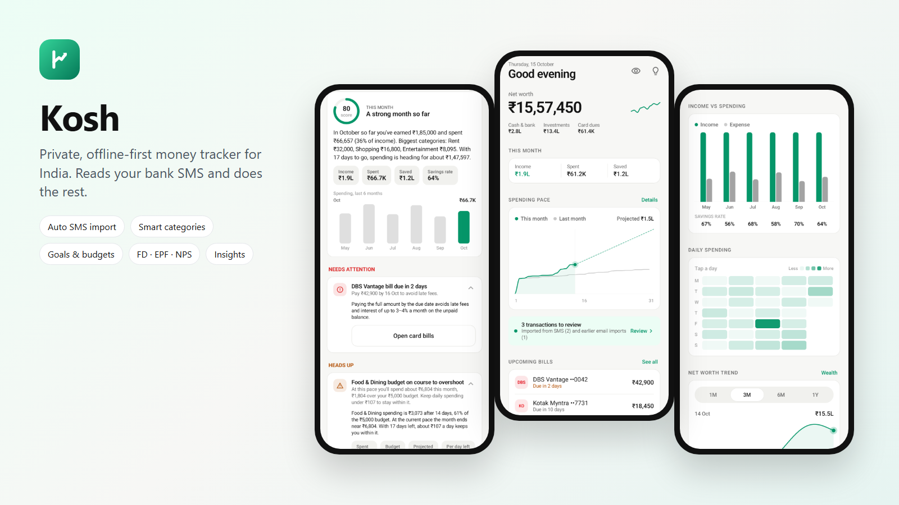</p>

## Screens

<table>
<tr>
<td align="center">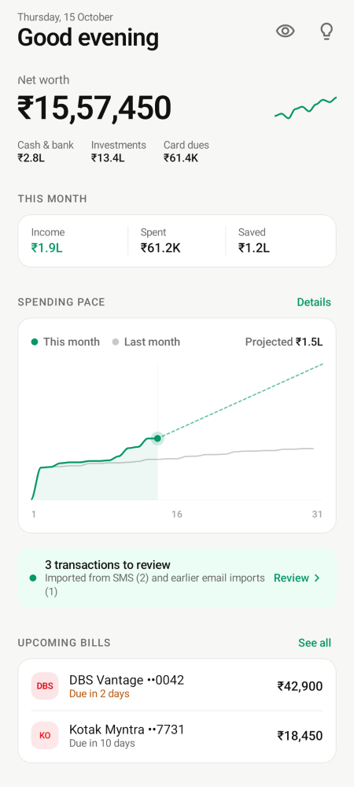<br><sub><b>Home</b>: net worth, month, spending pace</sub></td>
<td align="center">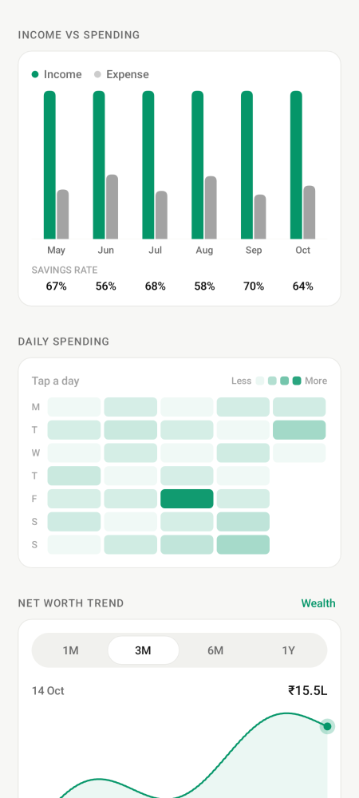<br><sub><b>Charts</b>: income vs spending, daily heatmap</sub></td>
<td align="center">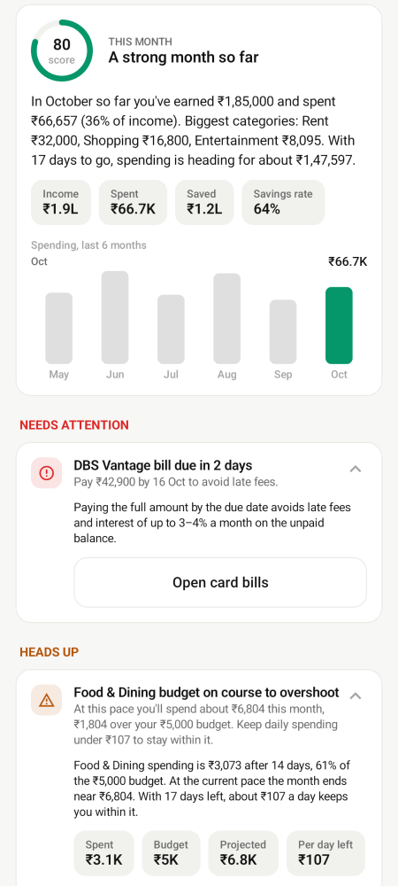<br><sub><b>Insights</b>: monthly score and advice</sub></td>
</tr>
<tr>
<td align="center">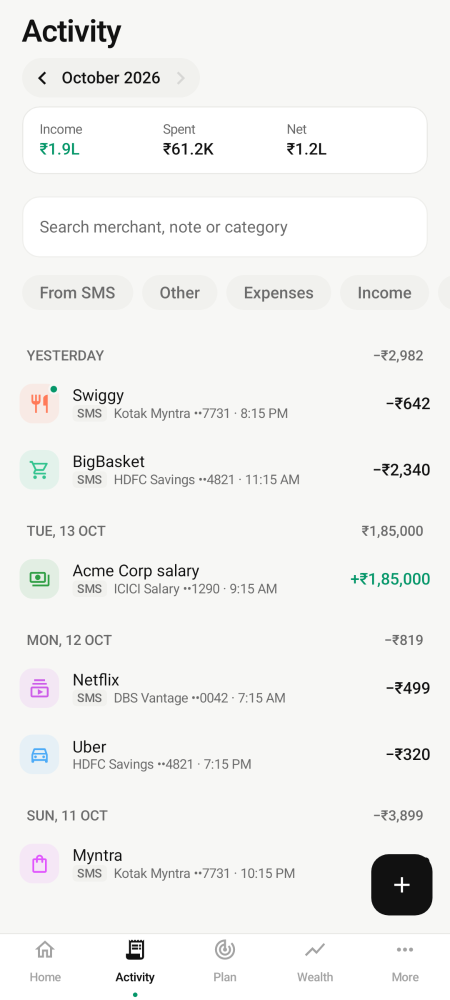<br><sub><b>Activity</b>: SMS imports, filters, review</sub></td>
<td align="center">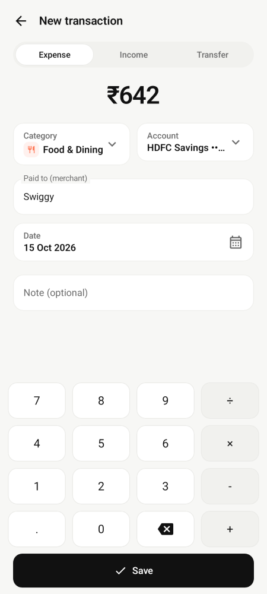<br><sub><b>Add</b>: calculator keypad entry</sub></td>
<td align="center">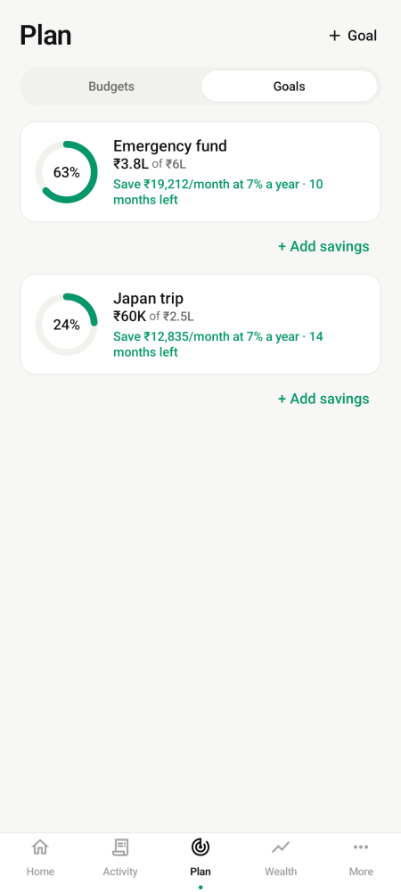<br><sub><b>Goals</b>: monthly saving, optional loan</sub></td>
</tr>
<tr>
<td align="center">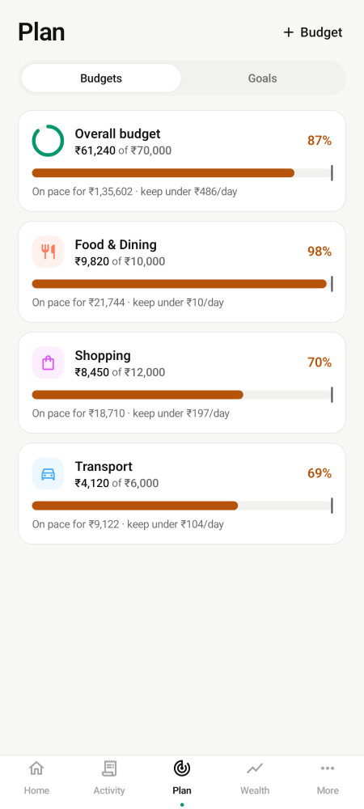<br><sub><b>Budgets</b>: pace and daily allowance</sub></td>
<td align="center">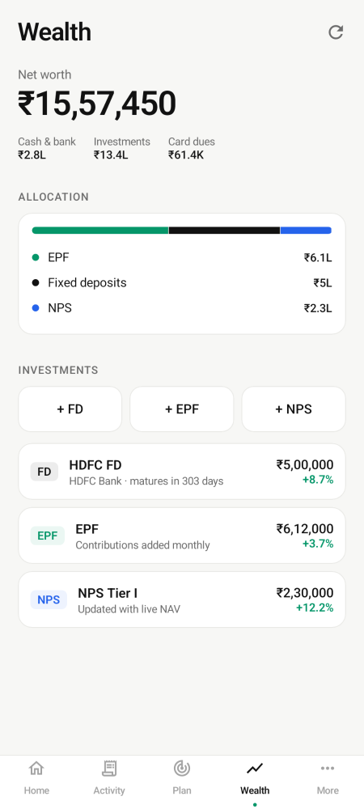<br><sub><b>Wealth</b>: FD, EPF, NPS, savings interest</sub></td>
<td align="center">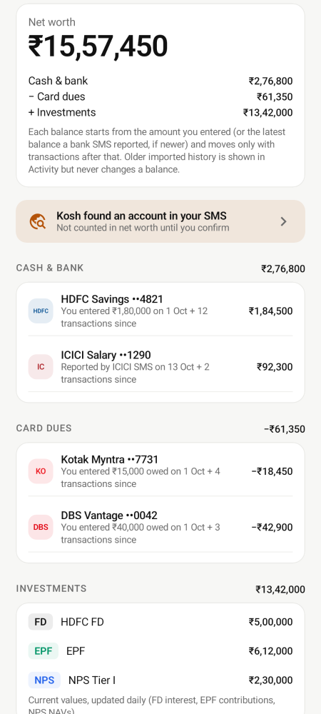<br><sub><b>Net worth</b>: how every number is calculated</sub></td>
</tr>
<tr>
<td align="center">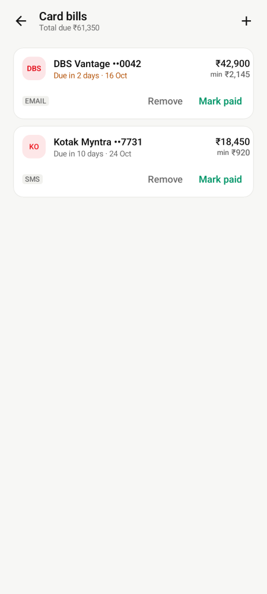<br><sub><b>Card bills</b>: due dates and reminders</sub></td>
<td align="center">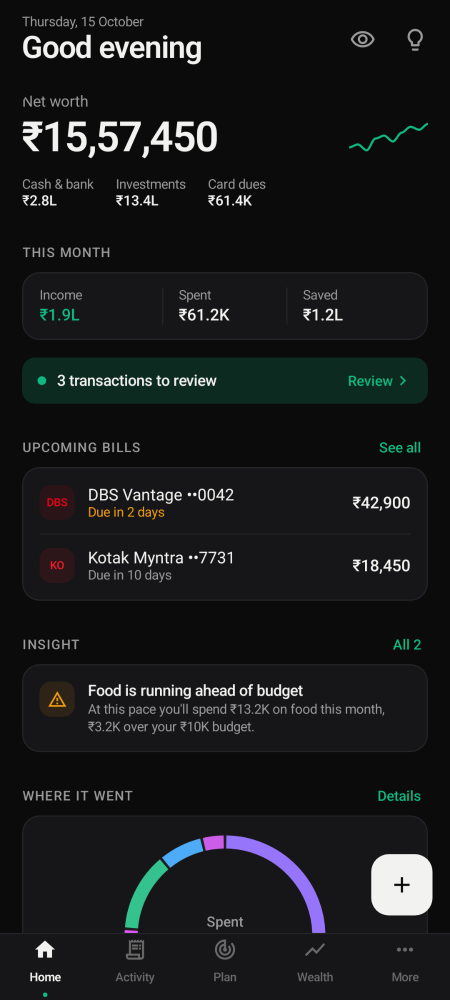<br><sub><b>Dark mode</b></sub></td>
<td align="center">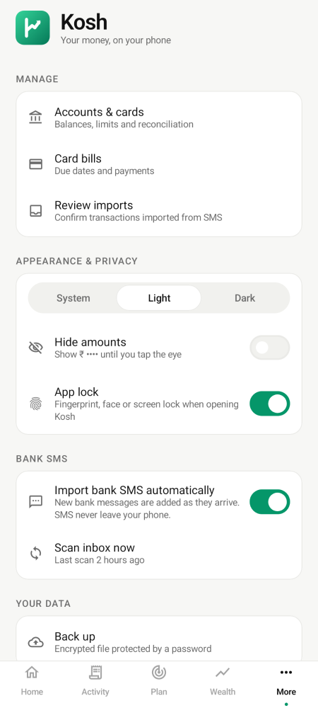<br><sub><b>Settings</b>: app lock, privacy, backup</sub></td>
</tr>
</table>

<sub>Screens are rendered from the app's own Compose UI with sample data (see the Paparazzi tests in <code>app/src/test</code>).</sub>

## Features

- **Automatic import:**
  - **Bank SMS:** ICICI, HDFC, Kotak and DBS messages, with a generic parser for other banks. New messages are picked up live, de-duplicated and sorted into categories.
  - **Credit-card bills:** read from card SMS, with due-date reminders.
  - **Review inbox:** confirm or fix imported transactions. Recategorising a merchant can remember that category for future imports.
- **Accounts and cards:** balances that reconcile with what bank SMS report, card outstanding and utilisation, and "mark paid" recording the transfer from your bank account.
- **Investments that update themselves:**
  - **FD:** interest accrues daily with quarterly compounding.
  - **EPF:** monthly contributions plus EPFO-style interest.
  - **NPS:** valued from live NAVs.
  - **Net worth:** tracked over time.
- **Planning:** monthly budgets with pace projection, and goals with the monthly saving they need.
- **Insights:** 17 offline rules, including budget pace, spending spikes, savings rate, subscriptions, card utilisation, emergency-fund cover, FD maturity and unusual spends.
- **Privacy and security:**
  - **Encrypted database:** SQLCipher (AES-256), with the key kept in the Android Keystore.
  - **Offline edition:** a build with no INTERNET permission at all, so Android itself guarantees nothing can be sent.
  - **Biometric lock, privacy mode and screenshot blocking.**
  - **Local-only data:** it stays on the device and is excluded from Google's cloud backup.
  - **Encrypted backups:** AES-256-GCM with a password-derived key (PBKDF2, 600k iterations).

## Architecture

| Module | Contents |
| :-- | :-- |
| `core:model` | Money (paise, Indian formatting), shared types |
| `core:sms` | Bank SMS parsers, merchant normalisation, category guessing |
| `core:finance` | FD/EPF/NPS valuation, NAV client, budgets and goals, insight engine |
| `core:designsystem` | Compose theme, charts, components, logo |
| `app` | Room database, repositories, SMS import, WorkManager jobs, UI screens |

Kotlin, Jetpack Compose with Material 3, Room with SQLCipher, WorkManager and DataStore. No Google Play Services.
The engine modules are plain Kotlin with unit tests.

## Building

```bash
./gradlew test                          # unit tests for every module
./gradlew :app:assembleStandardRelease  # standard edition (can fetch public NPS prices)
./gradlew :app:assembleOfflineRelease   # offline edition (no INTERNET permission)
```

The two editions have different application IDs (`com.amitjha.kosh` and `com.amitjha.kosh.offline`), so both
can be installed side by side. CI builds both on every push (see `.github/workflows/ci.yml`).

Release signing reads `keystore/kosh-release.jks` and the `KOSH_STORE_PASSWORD` / `KOSH_KEY_PASSWORD`
Gradle properties from `~/.gradle/gradle.properties`. Neither is committed.

Pushing a version tag (`git tag v2.0.1 && git push origin v2.0.1`) runs `.github/workflows/release.yml`, which
builds both editions with the release key and publishes them as a GitHub release (`Kosh.apk`, `Kosh-offline.apk`).
It reads the key from the `KOSH_KEYSTORE_BASE64`, `KOSH_STORE_PASSWORD` and `KOSH_KEY_PASSWORD` repository secrets.

## Contributing

Contributions are welcome, especially **bank SMS formats** and **merchant categories**. The merchant rules
live in an open dataset, [`core/sms/src/main/resources/kosh/merchants.json`](core/sms/src/main/resources/kosh/merchants.json)
(format in [docs/DATASET.md](docs/DATASET.md)). See [CONTRIBUTING.md](CONTRIBUTING.md), and always mask
account numbers before sharing an SMS. Security issues: see [SECURITY.md](SECURITY.md).

## License

Kosh is free software under the [GNU General Public License v3.0 or later](LICENSE).
